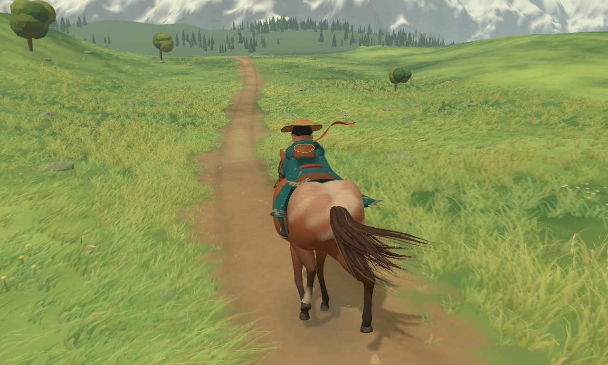

# 风过雪岭

在连绵的草坡上沿土路骑行。可以慢步、小跑或疾驰，转动镜头看雪山，听马蹄声，等风把远处的薄雾送过路面。路会随行程延伸，天色从清晨变到夜晚。



## 开始骑行

下载本仓库的 [风过雪岭.html](./风过雪岭.html)，用支持 WebGL 2 的桌面浏览器打开。页面包含完整游戏和 Three.js，断网也能运行。在 GitHub 文件页面可以点 **Download raw file** 保存 HTML。

| 操作 | 按键或手势 |
| --- | --- |
| 加速、减速 | W / S 或 ↑ / ↓ |
| 在土路上向左、向右微调 | A / D 或 ← / → |
| 环视、调整跟拍距离 | 拖动、滚动滚轮 |
| 暂停或继续 | 空格 |
| 切换时段 | T |
| 开关环境声 | M |

触屏界面提供方向和速度按钮，可拖动画面环视。

## 本地开发

使用 Python 3 和标准库即可构建。从仓库根目录执行以下命令，再刷新游戏页面。

```sh
python build.py
```

源文件位于 `src/`。构建脚本将 ES 模块、页面模板和仓库内的依赖打包为根目录的单文件游戏。修改源码后请重新构建，并将生成的 HTML 一起提交。

| 文件 | 职责 |
| --- | --- |
| `src/ride.js`、`src/shell.html` | 游戏循环、输入、相机、声音及界面 |
| `src/land.js`、`src/grass.js` | 地形分块、道路过渡、草叶和穗状草丛 |
| `src/sky.js`、`src/weather.js` | 昼夜、云层、雾和近景粒子 |
| `src/mount.js`、`src/stride.js`、`src/quarters.js` | 人马模型、步态和肌肉形变 |
| `src/mane.js`、`src/tail.js`、`src/tack.js` | 毛发、衣料、缰绳和骑手手臂 |

草场按路线分块生成。近处的草叶分段弯曲，宽叶和细叶有不同的弧度，部分草丛另长出草穗。远处使用简化草束，并逐渐减少实例数。阵风在世界坐标中移动，土路边缘的低草、草坡上的高草和雾团共享风向。

## 第三方依赖

Three.js r160 随项目保存在 `vendor/`，构建时会把其 [MIT 许可证](vendor/LICENSE-three.txt) 一并嵌入 HTML。
